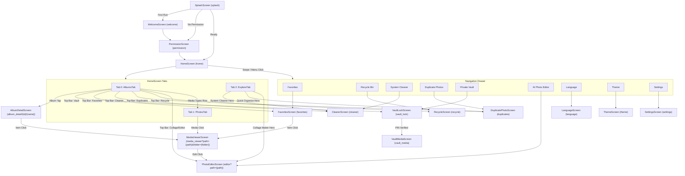

# Navigation Map & Architecture

This document defines the complete navigation topology, route arguments, back-stack behavior, and state transitions for the reconstructed Android Gallery app (`albums.gallery.photo.folder.picasa.app.web.gallery`).

---

## Navigation Graph Topology

---

## Detailed Route Specifications

| Route Name | Path Pattern | Arguments | Launch Mode / Back-Stack |
|---|---|---|---|
| **Splash** | `splash` | None | Root start destination; `popUpTo(inclusive=true)` on departure. |
| **Welcome** | `welcome` | None | Onboarding pager; `popUpTo(inclusive=true)` when completed. |
| **Permission** | `permission` | None | Storage check; `popUpTo(inclusive=true)` when granted. |
| **Home** | `home` | None | Main singleTop container managing 3 tabs (Albums, Photos, Explore). |
| **Album Detail** | `album_detail/{bucketId}/{bucketName}` | `bucketId: String`, `bucketName: String` (URL Encoded) | Standard push; back pops to Home. |
| **Media Viewer** | `media_viewer?path={path}&folder={folder}` | `path: String` (URL Encoded), `folder: String` (URL Encoded) | Immersive overlay; back pops to calling screen. |
| **Favorites** | `favorites` | None | Standard push; back pops to Home. |
| **Recycle Bin** | `recycle` | None | Standard push; back pops to Home. |
| **Duplicates** | `duplicates` | None | Standard push; back pops to Home or Cleaner. |
| **Cleaner** | `cleaner` | None | Standard push; contains sub-navigation to Duplicates. |
| **Photo Editor** | `editor?path={path}` | `path: String?` (Optional, URL Encoded) | Standalone editor or edit flow from MediaViewer. |
| **Vault Lock** | `vault_lock` | None | PIN verification; on success navigates to `vault_media` with `popUpTo(vault_lock, inclusive=true)`. |
| **Vault Media** | `vault_media` | None | Encrypted vault dashboard; back pops to Home. |
| **Language** | `language` | None | App locale selector; back pops to Home. |
| **Theme** | `theme` | None | App theme selector (Light/Dark/System); back pops to Home. |
| **Settings** | `settings` | None | Settings dashboard; back pops to Home. |

---

## Special Transitions & Lifecycle Behaviors

1. **Vault Lock Auto-Clear**:
   - The Vault Lock Screen does not retain entered PIN digits across back presses.
   - When transitioning into `vault_media`, the PIN keypad screen is popped from the back-stack so pressing the system back button returns the user directly to the main gallery, preventing unauthorized back navigation into an unlocked vault.

2. **Media Selection Mode Lifecycle**:
   - Long-pressing any media item in `PhotosTab` or `AlbumDetailScreen` enters selection mode.
   - System back button in selection mode dismisses the selection rather than popping the screen (`BackHandler(enabled = isSelectionMode) { viewModel.clearSelection() }`).
   - Bottom action bar morphs into batch actions: Share, Delete, and Move to Vault.

3. **URL Encoding for File Paths**:
   - All file paths and folder names passed through Navigation Compose arguments are strictly URL-encoded (`URLEncoder.encode(path, "UTF-8")`) and URL-decoded upon receipt to safely handle spaces, special characters, and slashes.
